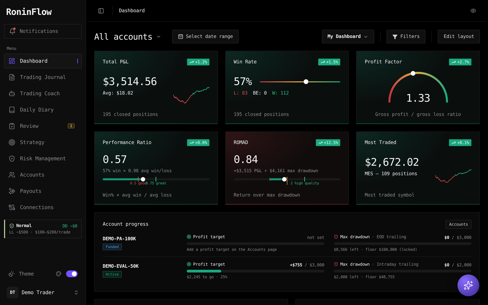
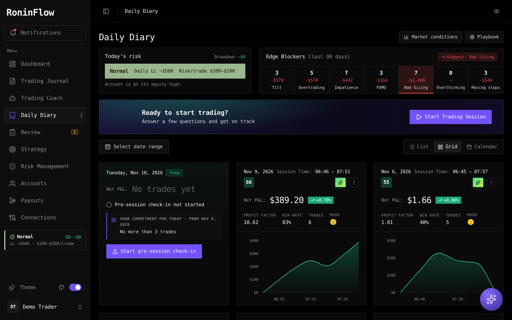
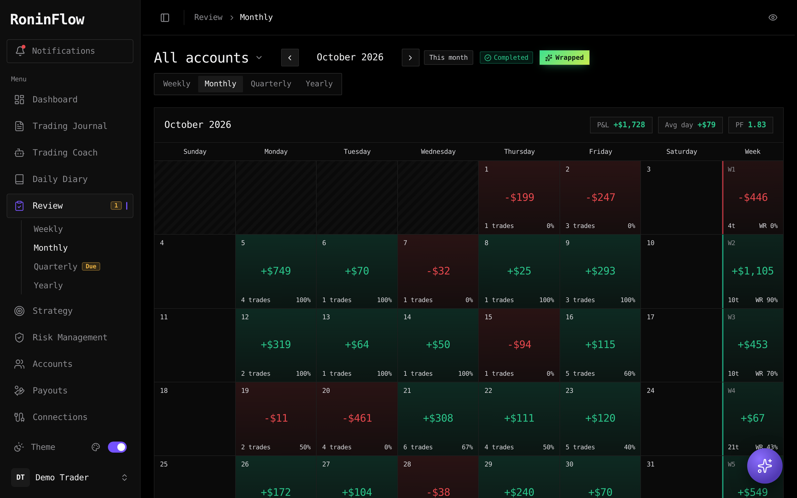
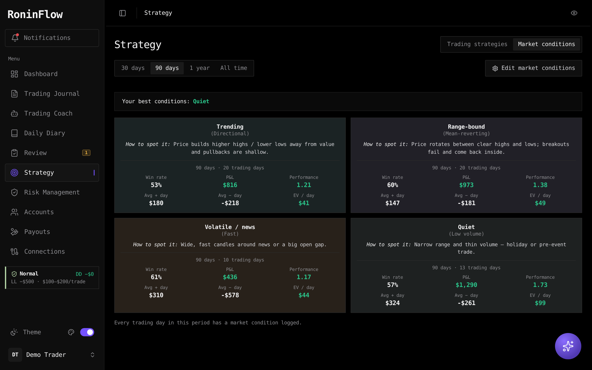
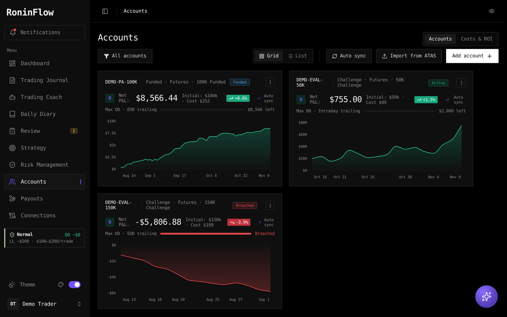
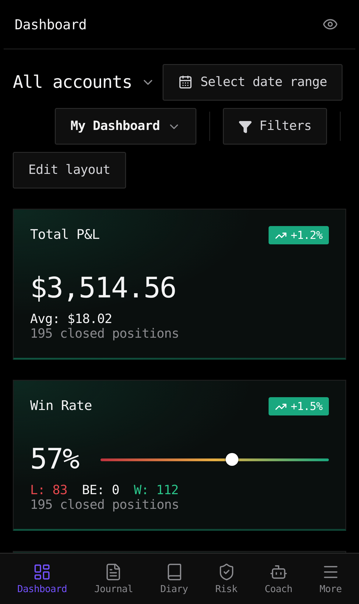

# RoninFlow

**A free, open-source trading journal you run yourself** — on Windows, macOS, Linux, a home server or a NAS. A self-hosted
alternative to TradeZella, Tradervue and Edgewonk for futures, stocks, forex and crypto traders. Your trades, diary,
reviews and screenshots stay on your own machine.

[](https://github.com/coreyheyman/roninflow/releases/latest)
[](LICENSE)
[](https://coreyheyman.github.io/roninflow/)
[](https://github.com/coreyheyman/roninflow/pkgs/container/roninflow)

**[▶ Try the live demo](https://coreyheyman.github.io/roninflow/)** (made-up data, runs in your browser) ·
**[⬇ Download for Windows](https://github.com/coreyheyman/roninflow/releases/latest)** ·
**[🍎🐧 macOS & Linux](docs/install.md#macos-and-linux)** ·
**[🐳 Docker](docs/install.md#docker-home-server-nas-raspberry-pi-45)**



## Features

- **Automatic trade import** from ATAS, NinjaTrader, MetaTrader 4/5, cTrader, Sierra Chart, Quantower, TopstepX/ProjectX,
  Tradovate, Interactive Brokers, Schwab, TradeStation, Alpaca, OANDA, tastytrade, Bybit, Binance, OKX, Bitget,
  Hyperliquid, Coinbase and Kraken — plus file import from most platforms and a webhook for anything else.
- **Daily diary** with pre/post-session routines, market conditions, edge blockers and execution charts.
- **Risk tiers** that move you between risk levels based on drawdown and recent days, prop-firm account rules
  (profit target, static / intraday / EOD trailing drawdown) and payouts / ROI.
- **Macro:** an economic calendar (list, week and month views, in your time zone, with forecasts and actuals) and the
  CFTC **COT report** — who's long, who's short and who's crowded across index, rates, FX, metals, energy and crypto futures.
- **Weekly → yearly reviews** with your own questions, and an **AI coach** (your own key, a free local model, or offline).
- **Private by design:** password protection, encrypted API keys, daily backups — nothing leaves your machine unless you
  connect a service yourself. (The Macro pages download public calendar and COT data when you open them; they send nothing about you.)
- 16 languages, themes, works on your phone, update notifications.

## Screenshots

| | |
|---|---|
|  |  |
| **Daily diary** — today's risk tier, edge blockers, session cards | **Reviews** — weekly to yearly, with your own questions |
|  |  |
| **Market conditions** — how you trade in each one | **Accounts** — prop-firm rules, drawdown, costs & payouts |

<p align="center"></p>

Licence: MIT (see `LICENSE`; third-party credits in `NOTICE.md`). Not financial advice.

## Install

| | |
|---|---|
| **Windows** | Download `RoninFlow-Setup-x.y.z.exe` from the [Releases page](https://github.com/coreyheyman/roninflow/releases/latest) and run it. It starts with Windows and opens in your browser at http://localhost:5173. |
| **macOS / Linux** | In Terminal: `curl -fsSL https://raw.githubusercontent.com/coreyheyman/roninflow/main/install.sh \| bash` — starts at login and opens at http://localhost:5173. Details: [docs/install.md](docs/install.md#macos-and-linux). |
| **Docker / home server** | `docker compose up -d` (see `docker-compose.yml`), open `http://<server>:5173`, and set your password with the setup code from `docker compose logs`. |
| **From source** | Node.js 20+: `npm install`, `npm run build`, `npm start` (or `npm run autostart:install` on Windows). |

The first start walks you through setup: name and language, a password, your platforms, your accounts and their
prop-firm rules, risk tiers and the AI coach. Full guide: [`docs/install.md`](docs/install.md). Using it away from home:
[`docs/remote-access.md`](docs/remote-access.md).

## Develop

```bash
npm install
npm run dev     # http://localhost:5173 (hot reload)
npm test        # importer, pairing and connector tests
npm run build   # production build into dist/
```

Releases: push a tag like `v1.2.0` — GitHub Actions (`.github/workflows/release.yml`) runs the tests, builds the
Docker image (ghcr.io) and the Windows installer, and publishes the release. Set `"repository"` in `package.json`
so installed copies can check for updates.

## Sections

| Route | What it does |
|---|---|
| `#/dashboard` | KPI cards (Total P&L, Win rate slider, Profit-factor gauge, Performance Ratio, ROMAD, Most traded), Net P&L chart (area / line / daily bars), average hold time, recent trades, plus extra widgets (daily P&L, weekday, hour, long vs short, symbols, calendar). Date range, filters, layout presets and **Edit layout** (show / hide / reorder widgets). |
| `#/journal/database` | Trade database: sortable / hideable columns, bulk select, pagination, List / Grid / Calendar views, **Add trade** (manual with auto P&L or **CSV import** — Tradovate/NinjaTrader performance exports supported). Click a trade for the detail drawer: strategy, tags, rating, notes, screenshots, review status. |
| `#/journal/inbox` | Unreviewed trades (badge count in the sidebar). |
| **Import** (Journal toolbar, or Accounts → Import from ATAS) | Drop an ATAS statistics export (.xlsx or .csv), a Tradovate performance CSV or any trade list. ATAS executions are paired into round-trip trades (scale-in/out, reversals, per-fill commissions; positions still open are left out until closed). Every account in the file is created or mapped, duplicates are skipped, and trades you already tagged or annotated are kept when you re-import. Column mapping, date format and time-shift controls handle non-standard files. |
| `#/coach` | Trading Coach chat with templates, chat history, context picker, image + voice input, request counter. Answers offline from your data, or connect an AI provider (your own key or a free local model) in the coach's settings. |
| `#/diary` | Daily Diary: **Start Trading Session** check-in wizard, Grid / List / Calendar views with session scores. Each day (`#/diary/YYYY-MM-DD`) has intraday P&L, trades, plan adherence checks, post-session review and rich-text notes. |
| `#/review/weekly` · `monthly` · `quarterly` · `yearly` | Periodic reviews. Each page has a calendar of daily P&L for the period (Mon–Fri strip, month grid, three months, or a 12-month heat map), review stats (EV, Performance Ratio, ROMAD, P&L, win rate, PF, Sharpe, biggest drawdown, avg winning/losing day, best/worst day, max consecutive winning/losing days, winning-day %, disciplined trades %, size management %) and the review prompts. ‹ › steps to past periods; answers save automatically; **Mark … reviewed** completes it. A review becomes due at 1:00 PM on the last weekday of the period: you get a notification and a **Due** badge in the sidebar until it's done. Last period's commitment is shown at the top. |
| `#/notebook` | Free-form notebook (not in the sidebar; open it at this address). |
| `#/strategy` | **Trading strategies** and **Market conditions** tabs: performance of each strategy and each market condition. 3-step strategy builder (Basics, Rules Engine, Media & Education). Strategy pages show stats from linked trades, equity curve and a pre-trade checklist. |
| `#/macro/calendar` | **Economic Calendar**: List (today / this week / next week), Week and Month views in your time zone, impact and currency filters, search, a countdown to the next release and the next high-impact event, beat / miss colouring, and earlier releases of each event. Data: ForexFactory's public weekly feed (this week and next; every week fetched is kept, so history builds up) plus official US release dates (Fed, BLS) for the months ahead. Fetched by RoninFlow's server at most every 30 minutes. |
| `#/macro/cot` | **COT Report**: about 30 futures markets from the CFTC's weekly Commitments of Traders (Legacy, futures only, ~3 years): large speculators' net position and weekly change, % long, COT index over 6M / 1Y / 3Y with *crowded long / short* flags, commercials, open interest and a trend line. Click a market for its chart and recent weeks; **Add market** searches every market in the report. Updates after each Friday release. |
| `#/accounts` | Account cards with equity charts, status menu, add / edit / delete, detail modal with profit-target / drawdown / daily-limit progress. |

Global: account switcher, notifications drawer, privacy mode (eye icon blurs all $ values), themes, language,
collapsible sidebar, floating mini-coach, Settings (user menu, bottom-left): language & time zone, security & privacy,
price data, backups & updates, about & credits.

## Review metrics

- **Performance Ratio** = win% × (avg win ÷ avg loss). Above 0.5 is good, above 0.75 is great.
- **ROMAD** = P&L ÷ biggest peak-to-trough drawdown in the same period. Below 1 means you were down more at some point than you made; above 2 is high-quality trading. It's negative for a losing period.
- **EV** = net P&L ÷ trades. **Sharpe** = mean daily P&L ÷ standard deviation of daily P&L × √252.
- **Disciplined trades** = trades not flagged with an edge blocker in your post-session reviews; **Size management** = trades not flagged
  as *Bad Sizing*. Both only count days that have a post-session review, and show "—" when there are none.

## Data

Everything lives in the data folder (`./data`, `%LOCALAPPDATA%\TradeJournal\data` for the Windows installer, `/data` in
Docker — or set `DATA_DIR`): `journal.json`, `images/`, `connect.json` (connections, logins encrypted), `vault.json` +
`secret.key` (encrypted API keys), `candles/` and `bars/` (price data), `backups/` (daily). A new journal starts empty;
setup can add a made-up `DEMO-50K` account to look around (remove it in Settings → General).

### Exporting from ATAS
Statistics → History → pick dates + all accounts → Load → **Executions** tab → gear icon → **Export Statistics**.

## ATAS auto sync (live + history)

The **Journal Sync** add-on runs inside ATAS X and sends every closed trade from every connected account to this
app (no manual exports). One-time setup:

1. Install the [.NET 10 SDK](https://dotnet.microsoft.com/download/dotnet/10.0) (Windows x64).
2. Close ATAS X, then in the RoninFlow folder run `npm run addon` – builds `atas-addon/JournalSync.cs` and copies the DLL to
   `%APPDATA%\ATAS X\Indicators` (pass `-- -AtasDir "D:\path\to\ATAS X"` if it's installed elsewhere).
3. Start ATAS X → any chart → Indicators → add **Journal Sync** (one chart is enough).
4. Keep RoninFlow running. The top bar shows **ATAS live**; new trades land in the Inbox within seconds.

How it works: the add-on reads ATAS's own statistics (`TradingStatisticsProvider.RawStatistics.HistoryMyTrades`,
the same data as the Statistics/Journal window) and POSTs to `http://localhost:5173/api/atas` – a receiver built
into the RoninFlow server (`atas-sync.js`, data kept in `data/atas-sync/`). It resends its full history on start and
every 10 minutes, so nothing is lost if the journal wasn't running. Trades are matched by ATAS trade ID and to trades
you already imported from a file (no duplicates; your notes/tags are kept). Time stamps are auto-detected.
Turn sync off per account on the Accounts page or in the sync window (top-bar badge).

## Playbook: routines, market conditions, edge blockers, risk tiers

- **Daily Diary → Start Trading Session**: your pre-session routine checklist, a mental check (yesterday's "do better
  tomorrow" and your biggest current edge blocker), today's market condition, and today's risk tier (prefills max loss).
- **Diary page**: today's risk and edge blockers at the top; each day has the pre-session checklist, post-session routine,
  edge blockers, "What will I do better tomorrow?" and a **Chart screenshots** gallery (click / drop / paste).
- **Market conditions**: your own list (e.g. trending, range-bound, news-driven). Tag each day with one and compare how
  you perform in each on Strategy → Market conditions.
- **Risk Management** (sidebar): drawdown from the account's equity peak mapped to your risk tiers, with rules for
  stepping down after losing days and back up after green days, today's remaining loss room, and a position-size
  calculator. Don't want it? Turn **Risk tiers** off in Settings → General.
- **Edge blockers (90 days)**: how often each one happened and the P&L of those sessions.
- Everything is editable: routines, market conditions and blockers (Diary → Playbook, or the pencil on each panel),
  review questions (**Edit questions** on any review), tiers and thresholds (Risk Management → Risk rules).

## Trading Coach AI providers

Coach → **Customization Settings** → pick a provider, paste the key, **Test connection & load models**, choose a
model, **Use …**, Save.

| Provider | Key | Notes |
|---|---|---|
| Built-in analytics | – | Offline formulas over your journal (default). |
| Anthropic Claude | console.anthropic.com | |
| OpenAI | platform.openai.com | Change the base URL for OpenAI-compatible servers (OpenRouter, LM Studio, Groq, vLLM…). |
| Google Gemini | aistudio.google.com | |
| Ollama (local) | none | Install Ollama, `ollama pull llama3.1`; default address `http://localhost:11434`. |
| Ollama Cloud | ollama.com/settings/keys | Base `https://ollama.com`. |

Requests go through a small relay in the RoninFlow server (`ai-proxy.js`, `/api/ai/proxy`) so providers that block browser
calls (CORS) still work; it only accepts requests from the journal page itself. API keys are encrypted on the server
(`data/vault.json`) and never sent back to the browser.

## Run in the background (no terminal) and start at every log-in

```bash
npm run autostart:install   # build, register a hidden "RoninFlow" scheduled task, start it, add a desktop shortcut
npm run autostart:restart   # restart it (rebuilds automatically when the code changed)
npm run autostart:remove    # stop it and remove it from start-up (journal data is kept)
npm run start               # run the production server in a terminal instead
```

`server.js` serves the built app plus the ATAS receiver and the Coach AI relay on `http://localhost:5173`
(this computer only), so your saved data, screenshots and the ATAS add-on keep working. The task runs at
log-in, restarts the server if it ever crashes, and logs to `logs/server.log`. Stop `npm run dev` before
installing - both use port 5173. Use `npm run dev` only when you want hot-reload while editing code.

## Use it on your phone (home Wi-Fi)

Phone access needs the background server (above); `npm run dev` only answers this PC.

1. `npm run autostart:restart` (or `npm run autostart:install` if you haven't installed it yet).
2. `npm run phone:firewall` - approve the admin prompt. It allows port 5173 on **Private** networks only.
3. Windows Settings → Network & internet → Wi-Fi → your network → set to **Private**.
4. In the journal on your PC: user menu (bottom-left) → **Phone & network access** → set a password → turn on
   **Allow devices on my home network**. It shows the address to open, e.g. `http://192.168.1.23:5173`.
5. Open that address on your phone, sign in once, then Add to Home Screen for an app icon.

The phone uses the same data as the PC (changes appear on the other device within a few seconds). It can't
change network settings without your password, and ATAS trades are only accepted from this PC. Turning network access
off, or **Sign out all devices**, locks phones out again. Away from home, use a VPN such as Tailscale rather
than opening the port on your router.

### Install it as an app (HTTPS via Tailscale)

Phones only install web apps from an `https://` address. With Tailscale on the PC and phone:

1. Tailscale admin → DNS: turn on **MagicDNS** and **HTTPS Certificates** (once).
2. On the PC: `npm run phone:https` — sets up `https://<your-pc>.<tailnet>.ts.net` with Tailscale Serve (remembered across restarts;
   `npm run phone:https -- -Off` removes it).
3. Network access must be on (it covers the HTTPS address too). On the phone open the https address, sign in with your password, then
   Chrome ⋮ → **Install app** (iPhone Safari: Share → **Add to Home Screen**).

Requests through Tailscale Serve still need the password — they're treated like any other device, never as the PC.

## Home-server standby copy (works while the PC is off)

The PC stays the home of the journal. A Linux home server (any machine with Node.js 22 you can reach over SSH, ideally on Tailscale) can run an always-on copy:

- **PC on:** the server forwards every request to the PC, so edits save straight into `data/journal.json` here. It also keeps a fresh copy of the journal, screenshots and the app.
- **PC off:** the server answers from its copy. Notes, diary entries, reviews and screenshots are saved there as pending changes, and a banner says "Your PC is offline".
- **PC back:** within about 15 seconds the server merges its pending changes into the PC journal, one item at a time (each diary day, review, note, trade or setting). Then it goes back to forwarding. If the same field was edited on both sides, the newer edit wins and the other version is saved on the server in `~/trade-journal/data/conflicts/`.

Set it up or update it from the PC with one command. It asks for the Linux password the first time:

```
npm run server:deploy -- -Target you@your-server
```

After that, `npm run server:deploy` is enough. App changes made on the PC also reach the server on their own within a minute.

Use the server's address on your phone and other devices. It's `https://<server>.<tailnet>.ts.net`, or `http://<server-address>:5173`. Sign in with the same password as on the PC.

Live ATAS sync and local Ollama need the PC to be on.

On the server, check the service with `systemctl --user status trade-journal` and read the logs in `~/trade-journal/logs/journal.log`.

## Connections (automatic trade import)

**Connections** in the sidebar lists every way to get trades in: live add-ons (ATAS, NinjaTrader 8, MetaTrader 4/5,
cTrader, Sierra Chart, Quantower beta), broker APIs (TopstepX/ProjectX, Tradovate, Interactive Brokers Flex, Alpaca,
OANDA, tastytrade, Charles Schwab, TradeStation), crypto exchanges (Bybit, Binance, OKX, Bitget, Hyperliquid, Coinbase, Kraken),
the webhook, and file imports with
export steps per platform (ATAS, TradingView, DeepCharts, NinjaTrader, Tradovate, R | Trader Pro, TopstepX, any CSV).

### Webhook / API

`POST /api/connect/ingest` with `Authorization: Bearer <token>` (token in Connections → Webhook / API; not needed
from the PC itself). Body:

```json
{ "source": "my-platform", "account": "SIM101",
  "fills":  [{ "id": "f1", "symbol": "MESZ6", "side": "Buy", "qty": 2, "price": 6012.25, "time": "2026-11-10T14:31:05Z", "commission": 0.62 }],
  "trades": [{ "id": "t1", "symbol": "MNQZ6", "direction": "Short", "qty": 1, "entryTime": "2026-11-10T07:42:10-08:00",
               "exitTime": "2026-11-10T07:49:55-08:00", "entryPrice": 25210.5, "exitPrice": 25188.25, "fees": 0.74 }] }
```

- Fills are paired into round-trip trades per source + account + contract on the server (scale-ins, partial exits,
  reversals); a trade appears once the position is flat. Pairing logic is shared with the file importer (`src/lib/pairing.js`).
- Times need a zone (ISO with `Z`/offset) or epoch ms. Re-sending an `id` updates rather than duplicates.
- The app pulls new trades every 15 s (`GET /api/connect/changes`), links them to trades already in the journal
  (e.g. from ATAS) instead of duplicating, creates missing accounts, and never overwrites your notes, tags or reviews.
- Received data is kept in `data/connect.json`.

### NinjaTrader 8 add-on

`npm run addon:nt` copies `ninjatrader-addon/JournalSync.cs` to `Documents\NinjaTrader 8\bin\Custom\AddOns\TradeJournalSync.cs`
and creates `Documents\NinjaTrader 8\journal-sync.txt`. Compile once in NinjaTrader (NinjaScript Editor → F5); it then
starts with NinjaTrader, sends every execution from every connected account (except Backtest/Playback) to
`/api/connect/ingest` as `source: "ninjatrader"`, re-sends today's executions on start (duplicates are ignored), retries
with back-off while the journal is unreachable, and posts a heartbeat every 30 s with balances and open P&L (these feed
balance-based P&L and drawdown like the ATAS balances). Settings file keys: `url`, `token`, `accounts`, `timezone`.

### MetaTrader 4 / 5

`npm run addon:mt` copies `metatrader-addon/TradeJournalSync.mq5` / `.mq4` into every terminal's `MQL5\Experts` /
`MQL4\Experts`. Attach the EA to any chart (no WebRequest permission or algo trading needed). MetaTrader can't make web
requests to a local address, so the EA writes closed trades (one JSON line each, P&L incl. commission and swap, times
converted to UTC with the broker's current offset) and a status file with balance/equity to
`%APPDATA%\MetaQuotes\Terminal\Common\Files\TradeJournal`. The journal server reads that folder every 10 s
(`MT_COMMON_DIR` overrides it, e.g. for Wine). Same PC only.

### cTrader cBot

`npm run addon:ctrader` copies `ctrader-addon/TradeJournalSync.cs` to the clipboard; paste it into a new cBot (cTrader 5+),
build, start one instance per account. Each closing deal is sent as a trade (cTrader's net profit) to
`/api/connect/ingest` as `source: "ctrader"`, plus a balance heartbeat every 30 s. It also appends the same lines to
`Documents\cAlgo\Data\cBots` (the only folder a cBot may write without extra permissions), which the server scans as a
fallback (`CTRADER_DATA_DIR` overrides it). Duplicates from the two paths are ignored.

### Quantower strategy (beta)

`npm run addon:qt` finds Quantower (or pass `-QuantowerPath`), and builds `quantower-addon/` with the .NET SDK into
`Quantower\Settings\Scripts\Strategies\TradeJournalSync`. Run "RoninFlow Sync" in Strategies Manager: it sends
fills from `Core.TradeAdded` (plus the last 30 days via `GetTrades`) as `source: "quantower"` with point values from the
symbol's tick size/cost, and balances every 30 s.

### Direct APIs (polled by the journal server)

Set up in Connections; credentials are encrypted in `data/connect.json` and never sent back to the browser.

| | Endpoint(s) | Every |
|---|---|---|
| TopstepX / ProjectX | `/api/Auth/loginKey`, `/api/Account/search`, `/api/Trade/search`, `/api/Contract/searchById` (other ProjectX firms: change the API address) | 1 min |
| Tradovate | `/auth/accesstokenrequest` (+ renew), `/account/list`, `/fill/list`, `/order/items`, `/contract/items` | 1 min |
| Interactive Brokers | Flex Web Service `SendRequest` → `GetStatement` (Activity Flex Query, XML, Trades → Executions) | 30 min |
| Alpaca | `/v2/account/activities/FILL`, `/v2/account` | 1 min |
| OANDA | `/v3/accounts`, `/v3/accounts/{id}/trades?state=CLOSED`, `/summary` | 1 min |
| tastytrade | OAuth refresh token → `/customers/me/accounts`, `/accounts/{n}/transactions`, `/balances` | 2 min |
| Bybit | `/v5/execution/list` (linear + spot), `/v5/account/wallet-balance` | 2 min |
| Binance | `/fapi/v1/income` (symbol discovery), `/fapi/v1/userTrades`, `/fapi/v2/account`; listed spot pairs via `/api/v3/myTrades` | 3 min |
| OKX | `/api/v5/account/positions-history`, `/api/v5/account/balance` | 2 min |
| Hyperliquid | `/info` `userFillsByTime`, `clearinghouseState` (public, wallet address) | 1 min |
| Coinbase | `/api/v3/brokerage/orders/historical/fills` (CDP key, ES256 JWT) | 2 min |
| Kraken | `/0/private/TradesHistory` | 5 min |
| Bitget | `/api/v2/mix/position/history-position` (classic) + `/api/v3/position/history-position` (unified), `/api/v2/mix/account/accounts` | 2 min |
| Charles Schwab | OAuth (sign-in pasted back, refresh token lasts 7 days) → `/trader/v1/accounts/accountNumbers`, `/accounts/{hash}/transactions?types=TRADE`, `/accounts/{hash}` | 2 min |
| TradeStation | OAuth (non-expiring refresh token) → `/v3/brokerage/accounts`, `/historicalorders`, `/orders`, `/balances` | 2 min |

Code: `connect-apis.js` (prop firms / futures brokers, file drops) and `connect-markets.js` (stock, forex and crypto).
A failed connection test pauses that connection so bad credentials aren't retried in the background. Crypto P&L uses
coin quantities (point value 1); spot fills can't open shorts, and fills the exchange marks as closing a position opened
before the history window are skipped (`closes`), so partial history doesn't create phantom trades.

### Sierra Chart study

`npm run addon:sierra` copies `sierrachart-addon/TradeJournalSync.cpp` into `C:\SierraChart\ACS_Source`; build it with
Analysis → Build Custom Studies DLL → Remote Build and add "RoninFlow Sync" to each chart you trade. It writes that
chart's fills (symbol + trade account, times converted to UTC, point value from the chart) to
`%LOCALAPPDATA%\TradeJournal\drop`, which the server reads every 10 s (`TJ_DROP_DIR` overrides it).

