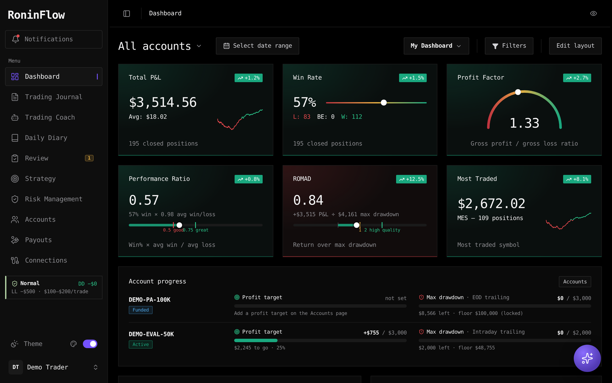
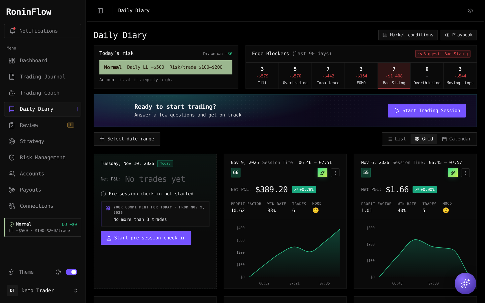
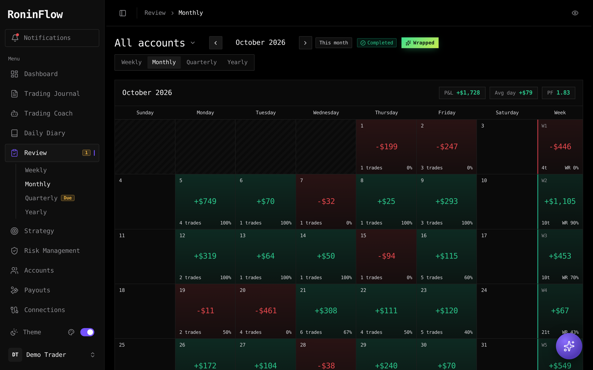
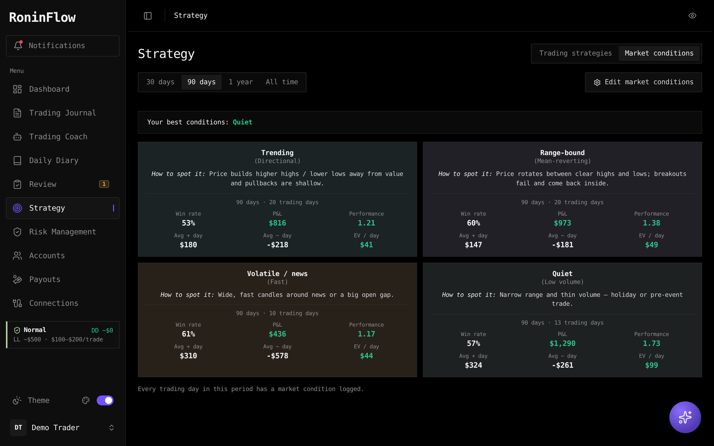
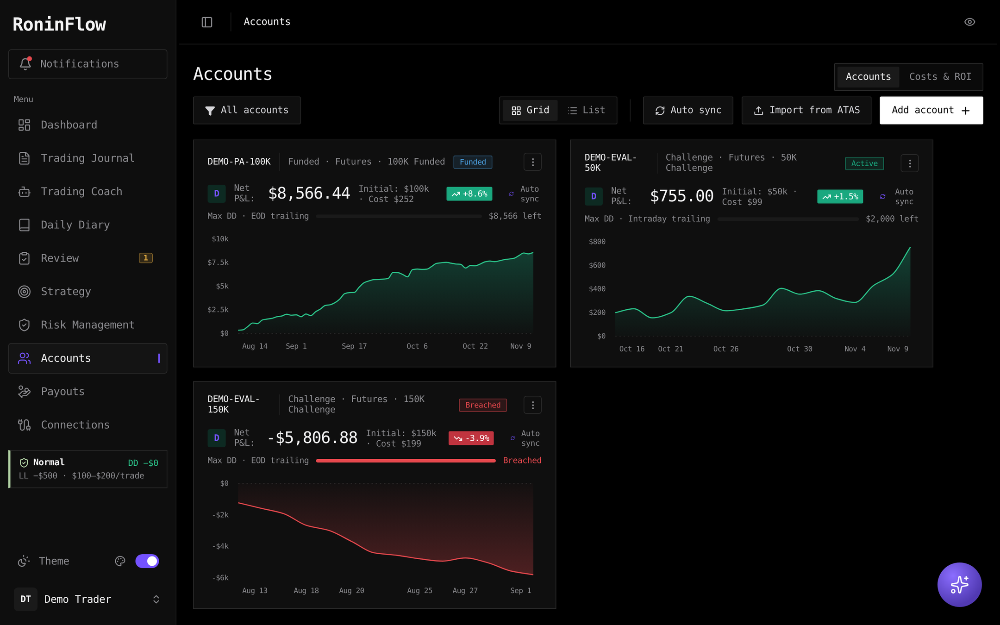
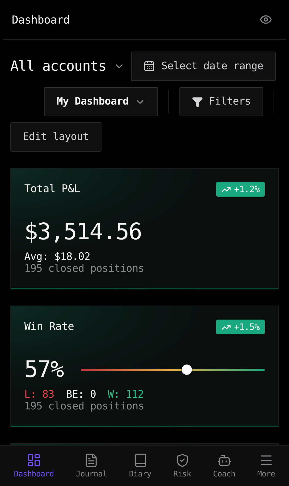

# RoninFlow

**A free, open-source trading journal you run yourself** — on Windows, macOS, Linux, a home server or a NAS. A self-hosted
alternative to TradeZella, Tradervue and Edgewonk for futures, stocks, forex and crypto traders. Your trades, diary,
reviews and screenshots stay on your own machine.

[](https://github.com/coreyheyman/roninflow/releases/latest)
[](LICENSE)
[](https://coreyheyman.github.io/roninflow/)
[](https://github.com/coreyheyman/roninflow/pkgs/container/roninflow)

**[▶ Try the live demo](https://coreyheyman.github.io/roninflow/)** (made-up data and prices — charts, tick replay, backtesting, Macro and snapshot sharing included — runs in your browser) ·
**[⬇ Download for Windows](https://github.com/coreyheyman/roninflow/releases/latest)** ·
**[🍎🐧 macOS & Linux](docs/install.md#macos-and-linux)** ·
**[🐳 Docker](docs/install.md#docker-home-server-nas-raspberry-pi-45)**



## Features

- **Automatic trade import** from ATAS, NinjaTrader, MetaTrader 4/5, cTrader, Sierra Chart, Quantower, TopstepX/ProjectX,
  Tradovate, Interactive Brokers, Schwab, TradeStation, Webull (beta), Alpaca, OANDA, tastytrade, Bybit, Binance, OKX, Bitget,
  Hyperliquid, Coinbase and Kraken — plus file import from most platforms and a webhook for anything else.
- **Build your own dashboards:** drag, resize and add from 30+ widgets; add, rename and delete as many dashboards as you like,
  each with its own layout. Includes the **Ronin Score** (one 0–100 health score from six parts, with a "weakest part"
  breakdown of what it says about your trading), **Custom Chart** widgets (any metric by weekday, hour, symbol, strategy,
  tag… with up to three metrics) and **Cross Analysis** (symbol × weekday / week / month / quarter heat map).
- **Full-screen charts with a market replay:** every execution chart in the diary opens full screen with drawing tools
  (trend lines, Fibonacci, rectangles, long / short positions, text you can resize and rotate, a **fixed-range volume
  profile**…), indicators (EMA, SMA, VWAP, Bollinger, RSI, MACD, **volume profile** for the visible range or each session —
  one row per tick, with POC and value area), timeframes from 1m to 1d, your colours and a screenshot button. Scroll left
  and earlier days load in. Then **replay the session** bar by bar — or **tick by tick** when a source has the ticks — with
  your fills appearing as they happened. Price bars come from your platform add-on (every add-on sends them), Databento,
  Polygon or Yahoo — each one switchable.
- **Backtesting**, three ways:
  - **Replay sessions:** pick any day and trade it as if live — an order panel like your platform's (market, bid / ask,
    limit and stop orders, cancel, reverse, breakeven, SL / TP brackets in ticks), **drag a LMT or STP button onto the
    chart** to place it at that price, drag order / stop / target tags to move them. Tick-by-tick from ATAS, NinjaTrader,
    Quantower, MetaTrader 5, cTrader, Sierra Chart, Databento or Polygon (real-time to 60×), else bar by bar. Restart from
    any bar, jump to any date; every simulated trade lands in the session's stats.
  - **What-if:** re-run your real trades with rules you didn't follow — max trades or losses a day, daily loss limit or
    target, max loss per trade, time window, weekdays, skip a strategy, symbol or tag — and see the new equity curve.
  - **Automated:** rules (or code) over your platform's full 1-minute history, downloaded by the add-on and joined at
    contract rolls. Market, stop and limit entries, trailing stops, breakeven, risk-based sizing, commission and
    slippage; a TradingView-style performance report, monthly table, drawdown, MAE / MFE per trade. Built against
    overfitting: a locked out-of-sample period, parameter sweeps that pick the most *robust* settings (not the luckiest),
    walk-forward, Monte Carlo, a +1 tick slippage test, a random-entry baseline and a luck test.
- **Daily diary** with pre/post-session routines, market conditions, edge blockers and execution charts.
- **Weekly → yearly reviews** with your own questions, market-condition and strategy cards with their stats, and an
  **AI coach** (your own key, a free local model, or offline).
- **Strategies and market conditions** side by side: P&L curve, win rate and EV per card, full stats on click.
- **Risk tiers and risk profiles** that move you between risk levels based on drawdown and recent days, days-to-ruin,
  prop-firm account rules (profit target, static / intraday / EOD trailing drawdown) and payouts / ROI.
- **Share view-only:** a live link or an offline snapshot file of your journal or one page — execution charts included —
  with account numbers hidden and optional hidden dollar amounts. **Sync trade reviews** across copy-traded accounts.
- **Macro:** an economic calendar (list, week and month views, in your time zone, with forecasts and actuals), the
  CFTC **COT report** — who's long, who's short and who's crowded across index, rates, FX, metals, energy and crypto futures —
  and **GEX** for SPX, NDX, RUT and their ETFs: call wall, put wall, gamma flip, GEX by strike, vanna and charm, every level
  converted to ES / NQ / RTY, with a *GEX levels* indicator for your charts (free Cboe data, or real time with Polygon or Tradier).
- **News:** live headlines from free feeds (the Fed, BLS, White House, Trump's posts, market wires, your calendar's releases)
  sorted into stories and **traced to the markets you trade** — each line's tone, the steps from it to your market, what the
  market did in the 15 minutes after, and earlier lines like it (**News Flow**); every macro driver for your market on one
  screen (**News Heat Map**); and **News Agents** — built-in ones, or yours in a sentence (“I'm long gold, tell me if anything goes
  against it”) — that alert you in the top bar. Built-in rules read every line for free; your Trading Coach's AI can read the important ones.
- **Private by design:** password protection, encrypted API keys, daily backups — nothing leaves your machine unless you
  connect a service yourself. (The Macro pages download public calendar, COT, options and news data; they send nothing about you.)
- Windows, macOS, Linux and Docker; 16 languages, themes, works on your phone, one-click updates.

## Screenshots

| | |
|---|---|
|  |  |
| **Full-screen chart** — drawing tools, indicators, volume profile, your executions | **Backtest replay** — trade any day tick by tick, drag orders onto the chart |
|  |  |
| **Automated backtests** — rules or code over years of 1-minute data | **Optimize without overfitting** — the most robust settings, not the luckiest |
|  |  |
| **What-if** — your real trades, re-run with the rules you meant to follow | **Economic calendar** — list, week and month, forecasts and actuals |
|  |  |
| **COT report** — who's long, who's short, who's crowded | **Your own dashboards** — Ronin Score, custom charts, cross analysis |
|  |  |
| **News Flow** — the story behind every move, and what each line means for your market | **News Heat Map** — every macro driver for your market, and whether price agrees |
|  |  |
| **Daily diary** — today's risk tier, edge blockers, session cards | **Reviews** — weekly to yearly, conditions and strategies |
|  |  |
| **Strategies** — P&L curve and stats per strategy | **Market conditions** — how you trade in each one |
|  |  |
| **Accounts** — prop-firm rules, drawdown, costs & payouts | **GEX** — dealer gamma levels, in your futures' prices |

<p align="center"></p>

Licence: MIT (see `LICENSE`; third-party credits in `NOTICE.md`). Not financial advice.

## Install

| | |
|---|---|
| **Windows** | Download `RoninFlow-Setup-x.y.z.exe` from the [Releases page](https://github.com/coreyheyman/roninflow/releases/latest) and run it. It starts with Windows and opens in your browser at http://localhost:5173. |
| **macOS / Linux** | In Terminal: `curl -fsSL https://raw.githubusercontent.com/coreyheyman/roninflow/main/install.sh \| bash` — starts at login and opens at http://localhost:5173. Details: [docs/install.md](docs/install.md#macos-and-linux). |
| **Docker / home server** | `docker compose up -d` (see `docker-compose.yml`), open `http://<server>:5173`, and set your password with the setup code from `docker compose logs`. |
| **From source** | Node.js 20+: `npm install`, `npm run build`, `npm start` (or `npm run autostart:install` on Windows). |

The first start walks you through setup: name and language, a password, your platforms, your accounts and their
prop-firm rules, risk tiers and the AI coach. Full guide: [`docs/install.md`](docs/install.md). Using it away from home:
[`docs/remote-access.md`](docs/remote-access.md).

## Develop

```bash
npm install
npm run dev     # http://localhost:5173 (hot reload)
npm test        # importer, pairing and connector tests
npm run build   # production build into dist/
```

Releases: bump `"version"` in `package.json` and push to main (or push a tag like `v1.2.0`) — GitHub Actions (`.github/workflows/release.yml`) runs the tests, builds the
Docker image (ghcr.io) and the Windows installer, and publishes the release. Set `"repository"` in `package.json`
so installed copies can check for updates.

## Sections

| Route | What it does |
|---|---|
| `#/dashboard` | Widget dashboards: KPI cards (Total P&L, Win rate, Profit factor, Performance Ratio, ROMAD, Ronin Score), Net P&L chart, account progress, hold time, edge blockers, weekday / hour / symbol breakdowns, average day and trade, streaks, risk, drawdown, calendar, Custom Chart and Cross Analysis widgets and more. Date range, filters, a dashboard picker (add / rename / delete dashboards) and **Edit layout** (drag, resize, add and remove widgets; saved per dashboard). |
| `#/journal/database` | Trade database: sortable / hideable columns, bulk select, pagination, List / Grid / Calendar views, **Add trade** (manual with auto P&L or **CSV import** — Tradovate/NinjaTrader performance exports supported). Click a trade for the detail drawer: strategy, tags, rating, notes, screenshots, review status. |
| `#/journal/inbox` | Unreviewed trades (badge count in the sidebar). |
| **Import** (Journal toolbar, or Accounts → Import from ATAS) | Drop an ATAS statistics export (.xlsx or .csv), a Tradovate performance CSV or any trade list. ATAS executions are paired into round-trip trades (scale-in/out, reversals, per-fill commissions; positions still open are left out until closed). Every account in the file is created or mapped, duplicates are skipped, and trades you already tagged or annotated are kept when you re-import. Column mapping, date format and time-shift controls handle non-standard files. |
| `#/coach` | Trading Coach chat with templates, chat history, context picker, image + voice input, request counter. Answers offline from your data, or connect an AI provider (your own key or a free local model) in the coach's settings. |
| `#/diary` | Daily Diary: **Start Trading Session** check-in wizard, Grid / List / Calendar views with session scores. Each day (`#/diary/YYYY-MM-DD`) has execution charts (open one full screen for drawing tools, indicators and bar-by-bar replay), intraday P&L, trades, plan adherence checks, post-session review and rich-text notes. |
| `#/review/weekly` · `monthly` · `quarterly` · `yearly` | Periodic reviews. Each page has a calendar of daily P&L for the period (Mon–Fri strip, month grid, three months, or a 12-month heat map), review stats (EV, Performance Ratio, ROMAD, P&L, win rate, PF, Sharpe, biggest drawdown, avg winning/losing day, best/worst day, max consecutive winning/losing days, winning-day %, disciplined trades %, size management %) and the review prompts. ‹ › steps to past periods; answers save automatically; **Mark … reviewed** completes it. A review becomes due at 1:00 PM on the last weekday of the period: you get a notification and a **Due** badge in the sidebar until it's done. Last period's commitment is shown at the top. Monthly, quarterly and yearly reviews also show a card per market condition and per strategy; click one for its full stats. |
| `#/notebook` | Free-form notebook (not in the sidebar; open it at this address). |
| `#/strategy` | **Trading strategies** and **Market conditions** tabs: a card per strategy / condition with its P&L curve, net P&L, win rate and EV over 30 days / 90 days / 1 year / all time; click for the full stats. 3-step strategy builder (Basics, Rules Engine, Media & Education). Strategy pages show stats from linked trades, equity curve and a pre-trade checklist. |
| `#/backtest` | **Backtesting.** *Replay*: sessions you trade day by day in the full-screen chart (order panel, drag-to-place limit / stop orders, draggable order / stop / target tags, tick-by-tick when a source has ticks, any date, restart from a bar) with the session's trades, stats and a comparison across sessions. *What-if*: your real trades re-run with daily and per-trade rules, time and weekday windows and skipped strategies / symbols / tags. *Automated* (`#/backtest/auto`): rule-builder or code strategies over your platform's downloaded 1-minute history — results, TradingView-style report, trades (MAE / MFE, CSV), Optimize (sweep ranked by robustness), Walk-forward, out-of-sample lock, Monte Carlo, slippage stress, random baseline and luck test. |
| `#/macro/calendar` | **Economic Calendar**: List (today / this week / next week), Week and Month views in your time zone, impact and currency filters, search, a countdown to the next release and the next high-impact event, beat / miss colouring, and earlier releases of each event. Data: ForexFactory's public weekly feed (this week and next; every week fetched is kept, so history builds up; checked every 30 minutes). Its feed has no actual figures, so actuals — and the weeks ForexFactory hasn't published — come from TradingView's public calendar feed, checked every few minutes around releases (unofficial; switch it off at the bottom of the page). Official US release dates (Fed, BLS) are the last fallback. Market and bank holidays for the US, UK, eurozone, Japan, Canada, Australia, New Zealand and Switzerland are worked out from each country's rules (`holidays.js`), so they show months ahead, marked *markets closed*, *early close* or *banks closed*. |
| `#/macro/cot` | **COT Report**: about 30 futures markets from the CFTC's weekly Commitments of Traders (Legacy, futures only, ~3 years): large speculators' net position and weekly change, % long, COT index over 6M / 1Y / 3Y with *crowded long / short* flags, commercials, open interest and a trend line. Click a market for its chart and recent weeks; **Add market** searches every market in the report. Updates after each Friday release. |
| `#/macro/gex` | **GEX**: dealer gamma exposure for SPX, NDX, RUT, SPY, QQQ, IWM (or any optionable ticker) and the expirations you pick (nearest by default): price, gamma zone (+γ mean-reverting / −γ trending), total GEX per 1% move, call wall, put wall and gamma flip; GEX by strike (calls up, puts down, net cumulative and total-GEX-by-price lines; scroll to zoom, drag to pan); vanna and charm for 0–45 and 46–180 days; a plain-English summary (your Trading Coach's AI, or a built-in one). Every level is also shown in ES / NQ / RTY prices, using your platform's price at the time of the data (or a price you type). Data: Cboe's free delayed quotes (~15 minutes, no key), or real time from Polygon (your key, options plan) or Tradier (a free brokerage account's token) — set under the gear icon. During US market hours the nearest expiration's levels of SPX and NDX are saved every 15 minutes (`data/gex/levels/`), and the **GEX levels** indicator in the full-screen chart draws them on ES / NQ / RTY charts — replays only show the levels known at the replay's time. Open interest updates once a day, so intraday levels use the morning's positions. |
| `#/macro/news` | **News Flow**: headlines from free feeds — Federal Reserve press releases and speeches, BLS releases, White House presidential actions, Trump's Truth Social posts (trumpstruth.org), investingLive, FXStreet, Investing.com, CNBC, MarketWatch, plus your economic calendar's releases with their actual vs forecast (and Finnhub with a free key, or any RSS feed you add) — checked every 1–10 minutes by the journal's server, kept 90 days (`data/news/`). Each line is sorted into a story (the Fed, Iran, tariffs, inflation, jobs…), read for its tone (hawkish / dovish, getting worse / calming down, hot / cool data, tariffs up / easing…) and traced to the markets you trade: tap the coloured word for the steps from the headline to your market (*Hawkish → rates stay high → bonds pay more → gold pays nothing → gold ▼*). Repeats and routine lines fold under the key line; a line that contradicts an earlier one is flagged; each line shows how your market moved in the 15 minutes after (your platform's prices, or Yahoo's); **Similar news** lists earlier lines with the same story and tone and what the market did next. Tabs: All, Top, Fed, Data, Wars, Trump, Trade, Energy. |
| `#/macro/heatmap` | **News Heat Map**: one market at a time (the ones you trade, plus any you add): tiles for the stories in the news, Fed comments, the latest inflation / jobs / growth surprises, the dollar and 2- / 10-year yields, oil, gold and the VIX — green where it helps the market, red where it hurts, stronger colour for a stronger push — a verdict (*News helps / hurts …*), and whether the market's 5-minute, 1-hour and 4-hour trend agrees. Tap a tile for the headlines behind it. Rates, dollar and linked markets use Yahoo's free quotes (can be switched off). |
| `#/macro/agents` | **News Agents**: Fed, Data, Trump and Geopolitics agents plus one per market you follow come switched on; add your own in a sentence — a position (“I'm long ES, tell me if anything goes against it”), a move (“anything that moves oil more than $1”) or keywords. They run on your computer around the clock and send one alert per headline to the **top-bar pill**, which pulses with the headline until you click it; the dropdown shows each alert's agents, why it fired, the market's price when it hit and its move in the 15 minutes after. Also here: the markets the news follows (everything you've traded in the last 120 days, plus any you add), the news sources with their status, and **AI** — off by default; when on, your Trading Coach's provider reads the important headlines and your sentence agents (capped at a number of requests an hour). |
| `#/accounts` | Account cards with equity charts, status menu, add / edit / delete, detail modal with profit-target / drawdown / daily-limit progress. |

Global: account switcher, notifications drawer, privacy mode (eye icon blurs all $ values), themes, language,
collapsible sidebar, floating mini-coach, Settings (user menu, bottom-left): language & time zone, security & privacy,
price data, backups & updates, about & credits.

## Review metrics

- **Performance Ratio** = win% × (avg win ÷ avg loss). Above 0.5 is good, above 0.75 is great.
- **ROMAD** = P&L ÷ biggest peak-to-trough drawdown in the same period. Below 1 means you were down more at some point than you made; above 2 is high-quality trading. It's negative for a losing period.
- **EV** = net P&L ÷ trades. **Sharpe** = mean daily P&L ÷ standard deviation of daily P&L × √252.
- **Disciplined trades** = trades not flagged with an edge blocker in your post-session reviews; **Size management** = trades not flagged
  as *Bad Sizing*. Both only count days that have a post-session review, and show "—" when there are none.

## Data

Everything lives in the data folder (`./data`, `%LOCALAPPDATA%\TradeJournal\data` for the Windows installer, `/data` in
Docker — or set `DATA_DIR`): `journal.json`, `images/`, `connect.json` (connections, logins encrypted), `vault.json` +
`secret.key` (encrypted API keys), `candles/` and `bars/` (price data), `backups/` (daily). A new journal starts empty;
setup can add a made-up `DEMO-50K` account to look around (remove it in Settings → General).

### Exporting from ATAS
Statistics → History → pick dates + all accounts → Load → **Executions** tab → gear icon → **Export Statistics**.

## ATAS auto sync (live + history)

The **Journal Sync** add-on runs inside ATAS X and sends every closed trade from every connected account to this
app (no manual exports). One-time setup:

1. Install the [.NET 10 SDK](https://dotnet.microsoft.com/download/dotnet/10.0) (Windows x64).
2. Close ATAS X, then in the RoninFlow folder run `npm run addon` – builds `atas-addon/JournalSync.cs` and copies the DLL to
   `%APPDATA%\ATAS X\Indicators` (pass `-- -AtasDir "D:\path\to\ATAS X"` if it's installed elsewhere).
3. Start ATAS X → any chart → Indicators → add **Journal Sync** (one chart is enough).
4. Keep RoninFlow running. The top bar shows **ATAS live**; new trades land in the Inbox within seconds.

How it works: the add-on reads ATAS's own statistics (`TradingStatisticsProvider.RawStatistics.HistoryMyTrades`,
the same data as the Statistics/Journal window) and POSTs to `http://localhost:5173/api/atas` – a receiver built
into the RoninFlow server (`atas-sync.js`, data kept in `data/atas-sync/`). It resends its full history on start and
every 10 minutes, so nothing is lost if the journal wasn't running. Trades are matched by ATAS trade ID and to trades
you already imported from a file (no duplicates; your notes/tags are kept). Time stamps are auto-detected.
Turn sync off per account on the Accounts page or in the sync window (top-bar badge).

## RoninFlow Suite indicator (on your charts)

One indicator that puts RoninFlow on the chart, each part switched on or off (and placed) in its settings: the
**account panel** (risk tier, gamma regime, today's P&L, the buffer from your stop to the profit target, trade stats,
GEX line, open positions on every account), **your executions** (entry / exit markers, the line joining them, the
result), **gamma levels** (flip, walls and big strikes as lines or zones), **news** (feed, pop-ups and today's
economic events), a **DOM heatmap**, **custom candles** and **alerts** (entries, fills, wins, losses, daily loss limit,
profit target). It reads `GET /api/suite?symbol=…&account=…` (JSON, or `&format=tsv` for MQL / C++); MetaTrader and
Sierra Chart swap files with the server instead (`suite-req-<id>.txt` → `suite-<id>.txt` in `Common\Files\TradeJournal`
or `%LOCALAPPDATA%\TradeJournal\drop`).

| Platform | Installed by | Account panel · executions · gamma · news · alerts | DOM heatmap | Candles | Clicks (collapse, open a headline) | Block trading from the chart |
|---|---|---|---|---|---|---|
| ATAS | `npm run addon` | ✓ | ✓ | ✓ drawn over the native candles | ✓ | ✓ (with Journal Sync's risk enforcement) |
| NinjaTrader 8 | `npm run addon:nt` | ✓ | ✓ | ✓ bar colours | ✓ | — |
| Quantower (beta) | `npm run addon:qt` | ✓ | ✓ | ✓ drawn over the bars | — | — |
| cTrader | `npm run addon:ctrader` | ✓ | ✓ (strongest 160 levels) | ✓ chart colours | ✓ | — |
| MetaTrader 5 / 4 | `npm run addon:mt` | ✓ (index CFDs get gamma in index prices) | MT5 where the broker sends depth | ✓ chart colours | ✓ | — |
| Sierra Chart | `npm run addon:sierra` | ✓ | use Sierra's Market Depth Historical Graph | use the chart's bar colours | — | — |

Everything but ATAS is written from each platform's documentation and still needs a first real compile — if one
shows errors, open an issue with them.

## Tick data for replays

Replays (and backtest replays) move tick by tick when a source has the ticks; otherwise they go bar by bar.

| Source | What you get | How |
|---|---|---|
| ATAS | trades, buyer / seller side | Journal Sync 1.5+ fetches each hour a replay needs from ATAS's trade history (keep it on a chart of that market — an ES chart serves MES) |
| NinjaTrader | trades | the add-on loads 1-tick bars from your data connection |
| Quantower | trades, aggressor side | the plug-in loads trade-tick history |
| MetaTrader 5 | trades where the broker has them, else bid quotes | the EA uses `CopyTicksRange` (MetaTrader 4 has no tick history) |
| cTrader | bid quotes | the cBot loads tick history |
| Sierra Chart | trades, side from bid / ask volume | the study reads a hidden 1-trade-per-bar chart |
| Databento / Polygon | trades (futures / stocks & crypto) | fetched directly with your key (Settings → Price data) |

Each hour is kept once it arrives (`data/ticks/`, compressed — a busy ES hour is ~0.6 MB), so it's never fetched twice.
In the background the add-ons also send the ticks around your trades (the hour before your first trade to the hour after
your last, last 14 days), so replays of those days start tick by tick right away — switch it off in Settings → Price data.
Shared links and snapshot files replay from the ticks you have saved. Any add-on fills in for trades from a broker
connection, a file or another platform too. Update an add-on to its latest version for ticks; older versions keep
working with bars.

## Playbook: routines, market conditions, edge blockers, risk tiers

- **Daily Diary → Start Trading Session**: your pre-session routine checklist, a mental check (yesterday's "do better
  tomorrow" and your biggest current edge blocker), today's market condition, and today's risk tier (prefills max loss).
- **Diary page**: today's risk and edge blockers at the top; each day has the pre-session checklist, post-session routine,
  edge blockers, "What will I do better tomorrow?" and a **Chart screenshots** gallery (click / drop / paste).
- **Market conditions**: your own list (e.g. trending, range-bound, news-driven). Tag each day with one and compare how
  you perform in each on Strategy → Market conditions.
- **Risk Management** (sidebar): drawdown from the account's equity peak mapped to your risk tiers, with rules for
  stepping down after losing days and back up after green days, today's remaining loss room, and a position-size
  calculator. Don't want it? Turn **Risk tiers** off in Settings → General.
- **Edge blockers (90 days)**: how often each one happened and the P&L of those sessions.
- Everything is editable: routines, market conditions and blockers (Diary → Playbook, or the pencil on each panel),
  review questions (**Edit questions** on any review), tiers and thresholds (Risk Management → Risk rules).

## Trading Coach AI providers

Coach → **Customization Settings** → pick a provider, paste the key, **Test connection & load models**, choose a
model, **Use …**, Save.

| Provider | Key | Notes |
|---|---|---|
| Built-in analytics | – | Offline formulas over your journal (default). |
| Anthropic Claude | console.anthropic.com | |
| OpenAI | platform.openai.com | Change the base URL for OpenAI-compatible servers (OpenRouter, LM Studio, Groq, vLLM…). |
| Google Gemini | aistudio.google.com | |
| Ollama (local) | none | Install Ollama, `ollama pull llama3.1`; default address `http://localhost:11434`. |
| Ollama Cloud | ollama.com/settings/keys | Base `https://ollama.com`. |

Requests go through a small relay in the RoninFlow server (`ai-proxy.js`, `/api/ai/proxy`) so providers that block browser
calls (CORS) still work; it only accepts requests from the journal page itself. API keys are encrypted on the server
(`data/vault.json`) and never sent back to the browser.

## Run in the background (no terminal) and start at every log-in

```bash
npm run autostart:install   # build, register a hidden "RoninFlow" scheduled task, start it, add a desktop shortcut
npm run autostart:restart   # restart it (rebuilds automatically when the code changed)
npm run autostart:remove    # stop it and remove it from start-up (journal data is kept)
npm run start               # run the production server in a terminal instead
```

`server.js` serves the built app plus the ATAS receiver and the Coach AI relay on `http://localhost:5173`
(this computer only), so your saved data, screenshots and the ATAS add-on keep working. The task runs at
log-in, restarts the server if it ever crashes, and logs to `logs/server.log`. Stop `npm run dev` before
installing - both use port 5173. Use `npm run dev` only when you want hot-reload while editing code.

## Use it on your phone (home Wi-Fi)

Phone access needs the background server (above); `npm run dev` only answers this PC.

1. `npm run autostart:restart` (or `npm run autostart:install` if you haven't installed it yet).
2. `npm run phone:firewall` - approve the admin prompt. It allows port 5173 on **Private** networks only.
3. Windows Settings → Network & internet → Wi-Fi → your network → set to **Private**.
4. In the journal on your PC: user menu (bottom-left) → **Phone & network access** → set a password → turn on
   **Allow devices on my home network**. It shows the address to open, e.g. `http://192.168.1.23:5173`.
5. Open that address on your phone, sign in once, then Add to Home Screen for an app icon.

The phone uses the same data as the PC (changes appear on the other device within a few seconds). It can't
change network settings without your password, and ATAS trades are only accepted from this PC. Turning network access
off, or **Sign out all devices**, locks phones out again. Away from home, use a VPN such as Tailscale rather
than opening the port on your router.

### Install it as an app (HTTPS via Tailscale)

Phones only install web apps from an `https://` address. With Tailscale on the PC and phone:

1. Tailscale admin → DNS: turn on **MagicDNS** and **HTTPS Certificates** (once).
2. On the PC: `npm run phone:https` — sets up `https://<your-pc>.<tailnet>.ts.net` with Tailscale Serve (remembered across restarts;
   `npm run phone:https -- -Off` removes it).
3. Network access must be on (it covers the HTTPS address too). On the phone open the https address, sign in with your password, then
   Chrome ⋮ → **Install app** (iPhone Safari: Share → **Add to Home Screen**).

Requests through Tailscale Serve still need the password — they're treated like any other device, never as the PC.

## Home-server standby copy (works while the PC is off)

The PC stays the home of the journal. A Linux home server (any machine with Node.js 22 you can reach over SSH, ideally on Tailscale) can run an always-on copy:

- **PC on:** the server forwards every request to the PC, so edits save straight into `data/journal.json` here. It also keeps a fresh copy of the journal, screenshots and the app.
- **PC off:** the server answers from its copy. Notes, diary entries, reviews and screenshots are saved there as pending changes, and a banner says "Your PC is offline".
- **PC back:** within about 15 seconds the server merges its pending changes into the PC journal, one item at a time (each diary day, review, note, trade or setting). Then it goes back to forwarding. If the same field was edited on both sides, the newer edit wins and the other version is saved on the server in `~/trade-journal/data/conflicts/`.

Set it up or update it from the PC with one command. It asks for the Linux password the first time:

```
npm run server:deploy -- -Target you@your-server
```

After that, `npm run server:deploy` is enough. App changes made on the PC also reach the server on their own within a minute.

Use the server's address on your phone and other devices. It's `https://<server>.<tailnet>.ts.net`, or `http://<server-address>:5173`. Sign in with the same password as on the PC.

Live ATAS sync and local Ollama need the PC to be on.

On the server, check the service with `systemctl --user status trade-journal` and read the logs in `~/trade-journal/logs/journal.log`.

## Connections (automatic trade import)

**Connections** in the sidebar lists every way to get trades in: live add-ons (ATAS, NinjaTrader 8, MetaTrader 4/5,
cTrader, Sierra Chart, Quantower beta), broker APIs (TopstepX/ProjectX, Tradovate, Interactive Brokers Flex, Alpaca,
OANDA, tastytrade, Charles Schwab, TradeStation, Webull beta), crypto exchanges (Bybit, Binance, OKX, Bitget, Hyperliquid, Coinbase, Kraken),
the webhook, and file imports with
export steps per platform (ATAS, TradingView, DeepCharts, NinjaTrader, Tradovate, R | Trader Pro, TopstepX, any CSV).

### Webhook / API

`POST /api/connect/ingest` with `Authorization: Bearer <token>` (token in Connections → Webhook / API; not needed
from the PC itself). Body:

```json
{ "source": "my-platform", "account": "SIM101",
  "fills":  [{ "id": "f1", "symbol": "MESZ6", "side": "Buy", "qty": 2, "price": 6012.25, "time": "2026-11-10T14:31:05Z", "commission": 0.62 }],
  "trades": [{ "id": "t1", "symbol": "MNQZ6", "direction": "Short", "qty": 1, "entryTime": "2026-11-10T07:42:10-08:00",
               "exitTime": "2026-11-10T07:49:55-08:00", "entryPrice": 25210.5, "exitPrice": 25188.25, "fees": 0.74 }] }
```

- Fills are paired into round-trip trades per source + account + contract on the server (scale-ins, partial exits,
  reversals); a trade appears once the position is flat. Pairing logic is shared with the file importer (`src/lib/pairing.js`).
- Times need a zone (ISO with `Z`/offset) or epoch ms. Re-sending an `id` updates rather than duplicates.
- The app pulls new trades every 15 s (`GET /api/connect/changes`), links them to trades already in the journal
  (e.g. from ATAS) instead of duplicating, creates missing accounts, and never overwrites your notes, tags or reviews.
- Received data is kept in `data/connect.json`.

### NinjaTrader 8 add-on

`npm run addon:nt` copies `ninjatrader-addon/JournalSync.cs` to `Documents\NinjaTrader 8\bin\Custom\AddOns\TradeJournalSync.cs`
and creates `Documents\NinjaTrader 8\journal-sync.txt`. Compile once in NinjaTrader (NinjaScript Editor → F5); it then
starts with NinjaTrader, sends every execution from every connected account (except Backtest/Playback) to
`/api/connect/ingest` as `source: "ninjatrader"`, re-sends today's executions on start (duplicates are ignored), retries
with back-off while the journal is unreachable, and posts a heartbeat every 30 s with balances and open P&L (these feed
balance-based P&L and drawdown like the ATAS balances). Settings file keys: `url`, `token`, `accounts`, `timezone`.

### MetaTrader 4 / 5

`npm run addon:mt` copies `metatrader-addon/TradeJournalSync.mq5` / `.mq4` into every terminal's `MQL5\Experts` /
`MQL4\Experts`. Attach the EA to any chart (no WebRequest permission or algo trading needed). MetaTrader can't make web
requests to a local address, so the EA writes closed trades (one JSON line each, P&L incl. commission and swap, times
converted to UTC with the broker's current offset) and a status file with balance/equity to
`%APPDATA%\MetaQuotes\Terminal\Common\Files\TradeJournal`. The journal server reads that folder every 10 s
(`MT_COMMON_DIR` overrides it, e.g. for Wine). Same PC only.

### cTrader cBot

`npm run addon:ctrader` copies `ctrader-addon/TradeJournalSync.cs` to the clipboard; paste it into a new cBot (cTrader 5+),
build, start one instance per account. Each closing deal is sent as a trade (cTrader's net profit) to
`/api/connect/ingest` as `source: "ctrader"`, plus a balance heartbeat every 30 s. It also appends the same lines to
`Documents\cAlgo\Data\cBots` (the only folder a cBot may write without extra permissions), which the server scans as a
fallback (`CTRADER_DATA_DIR` overrides it). Duplicates from the two paths are ignored.

### Quantower strategy (beta)

`npm run addon:qt` finds Quantower (or pass `-QuantowerPath`), and builds `quantower-addon/` with the .NET SDK into
`Quantower\Settings\Scripts\Strategies\TradeJournalSync`. Run "RoninFlow Sync" in Strategies Manager: it sends
fills from `Core.TradeAdded` (plus the last 30 days via `GetTrades`) as `source: "quantower"` with point values from the
symbol's tick size/cost, and balances every 30 s.

### Direct APIs (polled by the journal server)

Set up in Connections; credentials are encrypted in `data/connect.json` and never sent back to the browser.

| | Endpoint(s) | Every |
|---|---|---|
| TopstepX / ProjectX | `/api/Auth/loginKey`, `/api/Account/search`, `/api/Trade/search`, `/api/Contract/searchById` (other ProjectX firms: change the API address) | 1 min |
| Tradovate | `/auth/accesstokenrequest` (+ renew), `/account/list`, `/fill/list`, `/order/items`, `/contract/items` | 1 min |
| Interactive Brokers | Flex Web Service `SendRequest` → `GetStatement` (Activity Flex Query, XML, Trades → Executions) | 30 min |
| Alpaca | `/v2/account/activities/FILL`, `/v2/account` | 1 min |
| OANDA | `/v3/accounts`, `/v3/accounts/{id}/trades?state=CLOSED`, `/summary` | 1 min |
| tastytrade | OAuth refresh token → `/customers/me/accounts`, `/accounts/{n}/transactions`, `/balances` | 2 min |
| Bybit | `/v5/execution/list` (linear + spot), `/v5/account/wallet-balance` | 2 min |
| Binance | `/fapi/v1/income` (symbol discovery), `/fapi/v1/userTrades`, `/fapi/v2/account`; listed spot pairs via `/api/v3/myTrades` | 3 min |
| OKX | `/api/v5/account/positions-history`, `/api/v5/account/balance` | 2 min |
| Hyperliquid | `/info` `userFillsByTime`, `clearinghouseState` (public, wallet address) | 1 min |
| Coinbase | `/api/v3/brokerage/orders/historical/fills` (CDP key, ES256 JWT) | 2 min |
| Kraken | `/0/private/TradesHistory` | 5 min |
| Bitget | `/api/v2/mix/position/history-position` (classic) + `/api/v3/position/history-position` (unified), `/api/v2/mix/account/accounts` | 2 min |
| Charles Schwab | OAuth (sign-in pasted back, refresh token lasts 7 days) → `/trader/v1/accounts/accountNumbers`, `/accounts/{hash}/transactions?types=TRADE`, `/accounts/{hash}` | 2 min |
| TradeStation | OAuth (non-expiring refresh token) → `/v3/brokerage/accounts`, `/historicalorders`, `/orders`, `/balances` | 2 min |
| Webull (beta) | App Key + Secret (HMAC-SHA1 signed requests), access token approved once in the Webull app → `/trading/accounts/list`, `/trading/orders/historical-orders/list` | 2 min |

Code: `connect-apis.js` (prop firms / futures brokers, file drops) and `connect-markets.js` (stock, forex and crypto).
A failed connection test pauses that connection so bad credentials aren't retried in the background. Crypto P&L uses
coin quantities (point value 1); spot fills can't open shorts, and fills the exchange marks as closing a position opened
before the history window are skipped (`closes`), so partial history doesn't create phantom trades.

### Sierra Chart study

`npm run addon:sierra` copies `sierrachart-addon/TradeJournalSync.cpp` into `C:\SierraChart\ACS_Source`; build it with
Analysis → Build Custom Studies DLL → Remote Build and add "RoninFlow Sync" to each chart you trade. It writes that
chart's fills (symbol + trade account, times converted to UTC, point value from the chart) to
`%LOCALAPPDATA%\TradeJournal\drop`, which the server reads every 10 s (`TJ_DROP_DIR` overrides it).

